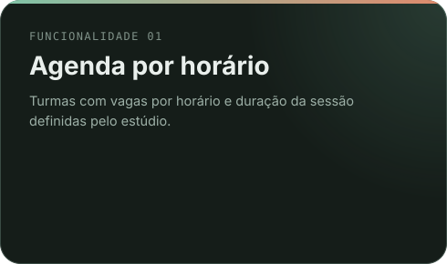
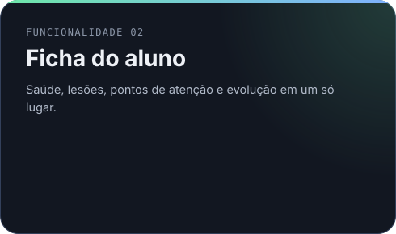
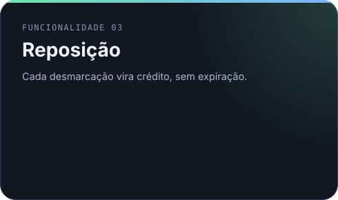
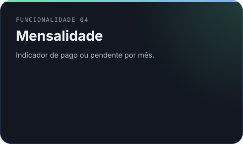
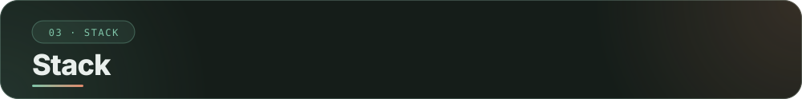
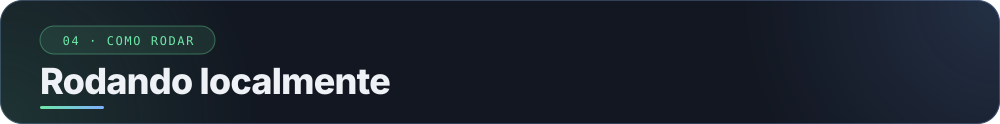
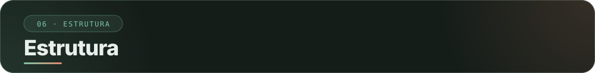

<!-- Arquivo gerado pelo readme-kit. Não edite aqui: altere docs/readme/ e rode "readme-kit build". -->
<div align="center">



<br />

<a href="https://agendamento-pilates.vercel.app"></a>
<a href="https://github.com/diegonatalo/agendamento-pilates"></a>

<br />


</div>

<br />

<div align="center">


</div>

**A agenda do estúdio de pilates, feita para a instrutora.**<br />
Sistema de agendamento para um estúdio de pilates, de uso exclusivo da dona e instrutora. As turmas têm até 3 alunos por horário e cada sessão dura 1h. Ela controla a agenda, a presença, as reposições, a mensalidade e a ficha de saúde de cada aluno. Os alunos não acessam o sistema.

<br />

<div align="center">


</div>

<div align="center">



<br />



</div>

<br />

<div align="center">



</div>

<div align="center">


</div>

<br />

<div align="center">



</div>

Requer [Node.js](https://nodejs.org) e [pnpm](https://pnpm.io).

```bash
git clone https://github.com/diegonatalo/agendamento-pilates.git
cd agendamento-pilates
pnpm install
pnpm dev        # http://localhost:3000
```

| Comando | O que faz |
|---|---|
| `pnpm dev` | Servidor de desenvolvimento |
| `pnpm build` | Gera o build de produção |
| `pnpm start` | Serve o build de produção |
| `pnpm lint` | Roda o ESLint |
| `pnpm test` | Roda os testes |
| `pnpm test:watch` | Roda os testes e reexecuta ao salvar |

### 🔑 Variáveis de ambiente

Nenhuma é necessária.

### 🧪 Testes

```bash
pnpm test
```

Cobrem a lógica em `lib/` (capacidade das turmas, conflito de horários, geração de sessões e saldo de reposição) e o comportamento dos componentes.

Para reexecutar ao salvar: `pnpm test:watch`.

<br />

<div align="center">



</div>

```text
app/              Apenas arquivos de rota
components/       Telas e componentes de interface
docs/             Fontes do README
hooks/            Estado e persistência no localStorage
lib/              Lógica pura, sem React
public/           Arquivos estáticos
types/            Tipos compartilhados do domínio
```

<br />

<div align="center">


</div>

### 🧠 Como funciona

| Conceito | Regra |
|---|---|
| **Turma** | Dia da semana e hora de início; até 3 alunos; 1h de duração; sem sobreposição. |
| **Sessão** | Uma turma em uma data, com a presença de cada aluno. |
| **Reposição** | Desmarcar gera 1 crédito, sem expiração; usar uma vaga livre consome 1. |
| **Bloqueio** | Feriados e férias bloqueiam as sessões e não geram crédito. |
| **Mensalidade** | Cada mês fica como pago ou pendente. |

### 🌐 Deploy

Ainda não publicado. Os dados ficam no `localStorage` do navegador da instrutora; o backup é exportado em JSON.

### 🧭 Próximos passos

- [x] Setup do projeto e testes
- [x] Alunos e grade de horários
- [ ] Agenda, presença e bloqueio de datas
- [ ] Desmarcar, reposição e aula experimental
- [ ] Mensalidade
- [ ] Backup, acessibilidade e deploy

<br />

<div align="center">


</div>

<div align="center">

<a href="https://diegonatalo.dev"></a>
<a href="https://www.linkedin.com/in/diegonatalo/"></a>
<a href="https://github.com/diegonatalo"></a>

</div>

<br />

<div align="center">


</div>
