<!-- Arquivo gerado pelo readme-kit. Não edite aqui: altere docs/readme/ e rode "readme-kit build". -->
<div align="center">


<br />

<a href="https://dn-encaixe.vercel.app"></a>
<a href="https://github.com/diegonatalo/encaixe"></a>

<br />


</div>

<br />

<div align="center">

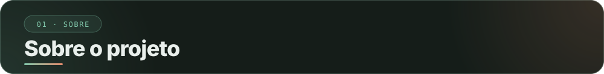

</div>

**A agenda de estúdios e professores com turmas fixas.**<br />
Encaixe é um sistema de agendamento para estúdios e professores com turmas fixas, como pilates, yoga, funcional e aulas particulares. Quem dá as aulas define a duração da sessão e quantos alunos cabem em cada horário, e controla a agenda, a presença, as reposições, a mensalidade e a ficha de saúde de cada aluno. Os alunos não acessam o sistema. Cada estúdio tem a própria conta, e os dados ficam num banco Postgres.

<br />

<div align="center">

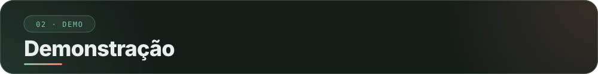

</div>

<div align="center">

<sub>Prints no tema claro, com dados de exemplo.</sub>

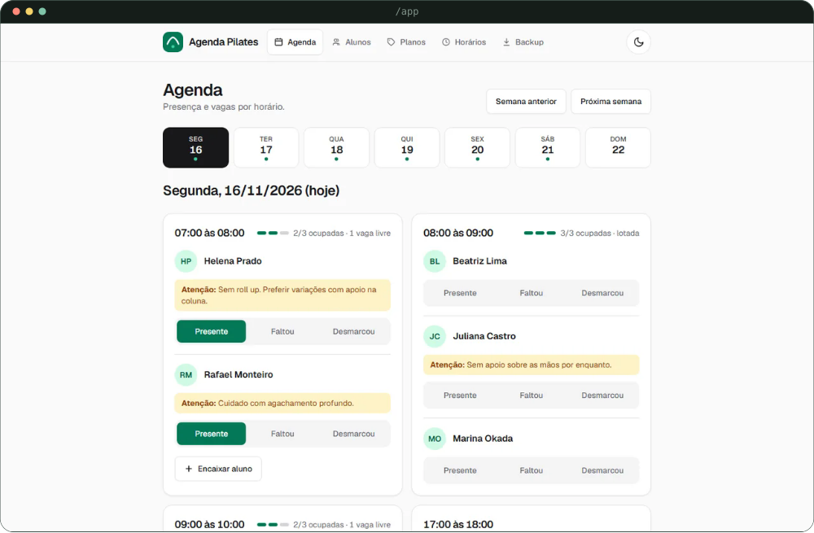
<br />
<sub>Agenda do dia: vagas por horário, pontos de atenção e presença com um toque.</sub>

<br />

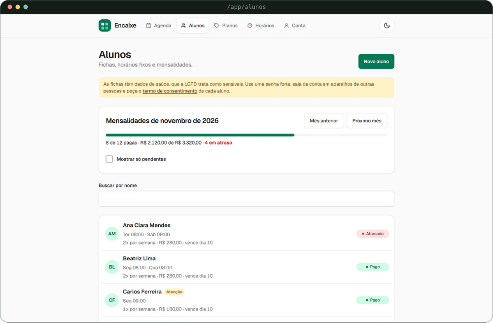
<br />
<sub>Alunos com horários fixos, plano e mensalidade paga ou pendente no mês.</sub>

<br />

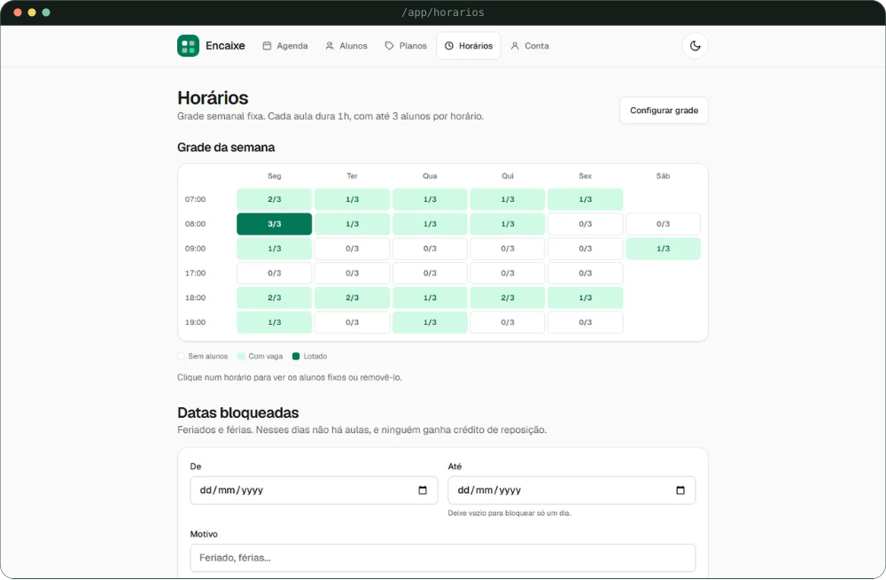
<br />
<sub>Grade da semana com a ocupação de cada turma e as datas bloqueadas.</sub>

<br />

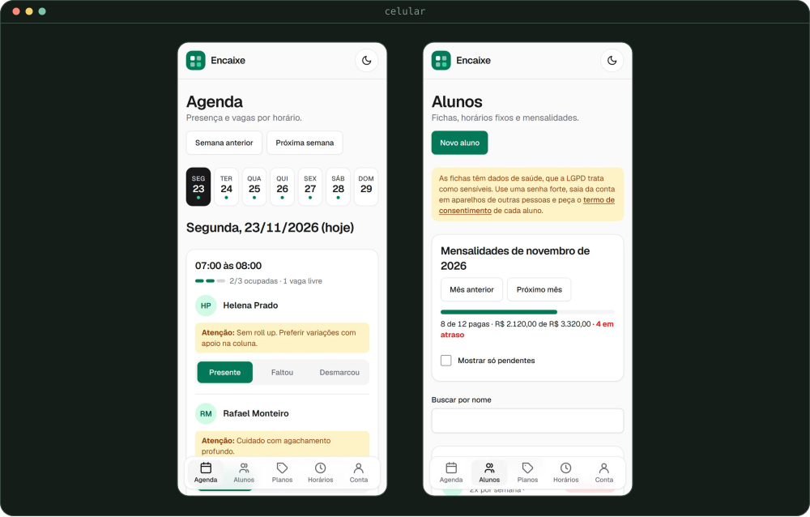
<br />
<sub>No celular, com a barra de navegação embaixo.</sub>

</div>

<br />

<div align="center">

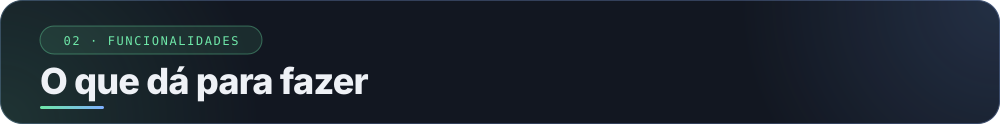

</div>

<div align="center">


<br />


<br />
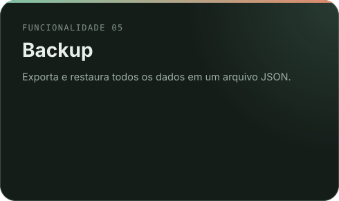

<br />
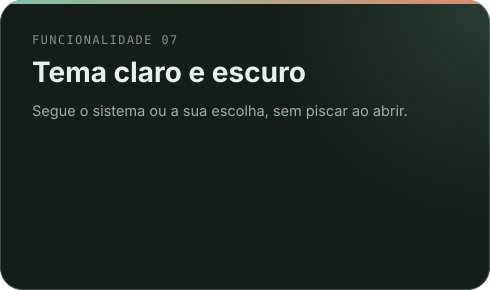

</div>

<br />

<div align="center">


</div>

<div align="center">


</div>

<br />

<div align="center">


</div>

Requer [Node.js](https://nodejs.org) e [pnpm](https://pnpm.io).

```bash
git clone https://github.com/diegonatalo/encaixe.git
cd encaixe
pnpm install
cp .env.example .env.local   # preencha o banco e o segredo
pnpm db:migrate
pnpm dev        # http://localhost:3000
```

| Comando | O que faz |
|---|---|
| `pnpm dev` | Servidor de desenvolvimento |
| `pnpm build` | Gera o build de produção |
| `pnpm start` | Serve o build de produção |
| `pnpm lint` | Roda o ESLint |
| `pnpm test` | Roda os testes |
| `pnpm test:watch` | Roda os testes e reexecuta ao salvar |
| `pnpm test:e2e` | Roda os testes de ponta a ponta (Playwright) |
| `pnpm db:generate` | Gera uma migração a partir do `lib/db/schema.ts` |
| `pnpm db:migrate` | Aplica as migrações no banco do `.env.local` |
| `pnpm vercel-build` | Migrações e build, usado pela Vercel |

### 🔑 Variáveis de ambiente

Veja [`.env.example`](.env.example).

| Variável | Descrição | Se não definir |
|---|---|---|
| `DATABASE_URL` | URL do Postgres (Neon), com pooler. Em desenvolvimento, use uma branch `dev`, nunca a de produção. | O app não abre |
| `DATABASE_URL_UNPOOLED` | URL sem pooler, usada pelas migrações. | As migrações usam a `DATABASE_URL` |
| `BETTER_AUTH_SECRET` | Segredo que assina os cookies de sessão. Gere com `openssl rand -base64 32`, um por ambiente. | Em produção, o login e o app dão erro |
| `BETTER_AUTH_URL` | Endereço do site em desenvolvimento e nos testes, sem barra no final. Na Vercel não precisa: vale o `SITE_URL`. | Better Auth deduz pela requisição e avisa no log |
| `NEXT_PUBLIC_SITE_URL` | URL pública do site, usada nas tags Open Graph, no `robots.txt` e no `sitemap.xml`. Sem barra no final. | Usa `https://dn-encaixe.vercel.app` |

### 🧪 Testes

```bash
pnpm test
```

Cobrem a lógica em `lib/` (capacidade das turmas, conflito de horários, geração de sessões e saldo de reposição) e o comportamento dos componentes.

Para reexecutar ao salvar: `pnpm test:watch`.

Os testes de ponta a ponta (Playwright, em `e2e/`) abrem o app no Chromium e percorrem os fluxos inteiros com uma conta nova por teste: criar a conta, entrar e sair, senha errada, e-mail repetido, isolamento entre contas e excluir a conta; montar a grade, cadastrar um aluno e recarregar; baixar o backup e restaurar numa conta nova; e abrir todas as páginas sem erros. Usam o banco do `.env.local` (no CI, um Postgres descartável).

```bash
pnpm exec playwright install chromium   # só na primeira vez
pnpm test:e2e                           # gera o build e testa contra ele
```

<br />

<div align="center">


</div>

```text
app/              Apenas arquivos de rota: landing (/), o app em /app, /entrar, /cadastro, /privacidade, /termos e a API de login
components/       Telas e componentes de interface
docs/             Fontes do README
e2e/              Testes de ponta a ponta (Playwright)
drizzle/          Migrações do banco (geradas pelo Drizzle)
hooks/            Estado do estúdio e tema
lib/              Lógica pura, sem React; lib/db (schema e conexão) e lib/data (leitura e Server Actions)
public/           Arquivos estáticos
types/            Tipos compartilhados do domínio
```

<br />

<div align="center">


</div>

### 🧠 Como funciona

| Conceito | Regra |
|---|---|
| **Turma** | Dia da semana e hora de início; até 3 alunos; 1h de duração; sem sobreposição. |
| **Sessão** | Uma turma em uma data, com a presença de cada aluno. |
| **Reposição** | Desmarcar gera 1 crédito, sem expiração; encaixar o aluno em uma vaga livre consome 1; cancelar a reposição devolve. |
| **Aula experimental** | Vaga livre para quem ainda não é aluno, só com o nome. |
| **Bloqueio** | Feriados e férias bloqueiam as sessões e não geram crédito. |
| **Mensalidade** | Cobra-se aluno ativo com valor definido, a partir do mês em que começou. Cada mês fica pago, pendente ou atrasado (depois do vencimento); dia 31 em mês curto vence no último dia. Os totais usam o valor atual da ficha. |

### 🌐 Deploy

Na Vercel, com o banco Postgres do Neon ligado pela integração da Vercel (ela cria a `DATABASE_URL` e a `DATABASE_URL_UNPOOLED`).

- Defina `BETTER_AUTH_SECRET` em Settings > Environment Variables, com um valor só da produção.
- O script `vercel-build` aplica as migrações pendentes (`drizzle-kit migrate`) antes do build. A Vercel só publica a `main` (`vercel.json`).
- `NEXT_PUBLIC_SITE_URL` é opcional e define o endereço usado em metadados e no sitemap; sem ela vale `https://dn-encaixe.vercel.app`.
- O app logado (`/app`) e a API pedem `noindex` e ficam fora do `robots.txt`.

### 💾 Backup

Na aba **Conta**, o backup baixa um arquivo `encaixe-backup-AAAA-MM-DD.json` com horários, alunos, presenças, datas bloqueadas e pagamentos, e restaura a partir dele (substituindo os dados atuais da conta, depois de confirmar). Serve para guardar uma cópia ou levar os dados para outra conta. Arquivos de outro app, de outra versão ou incompletos são recusados sem alterar nada.

O arquivo tem dados de saúde e contato dos alunos, **sem criptografia**: guarde em local seguro.

### 🧭 Próximos passos

- [x] Setup do projeto e testes
- [x] Alunos e grade de horários
- [x] Agenda, presença e bloqueio de datas
- [x] Desmarcar, reposição e aula experimental
- [x] Mensalidade
- [x] Backup e acessibilidade
- [x] Conta com login e dados no banco
- [ ] Publicar e definir o endereço final
- [ ] Serviço de e-mail para recuperar a senha
- [ ] Guardar o valor da mensalidade de cada mês

### 📄 Créditos e licença

- Distribuído sob a licença **MIT**. Veja o arquivo [LICENSE](LICENSE).

<br />

<div align="center">

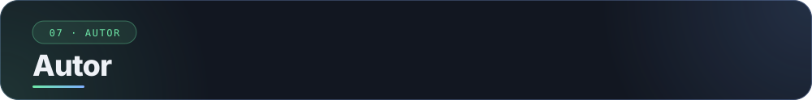

</div>

<div align="center">

<a href="https://diegonatalo.dev"></a>
<a href="https://www.linkedin.com/in/diegonatalo/"></a>
<a href="https://github.com/diegonatalo"></a>

</div>

<br />

<div align="center">

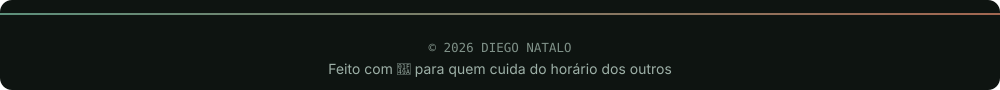

</div>
